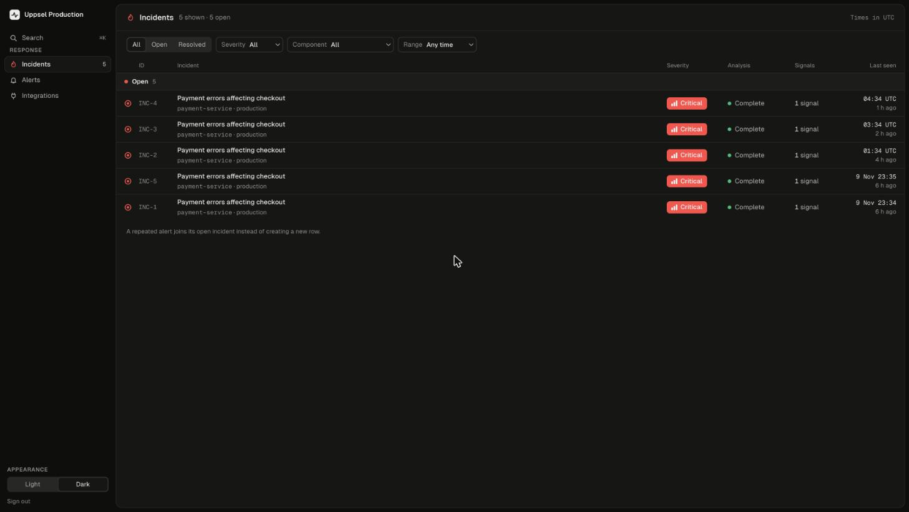
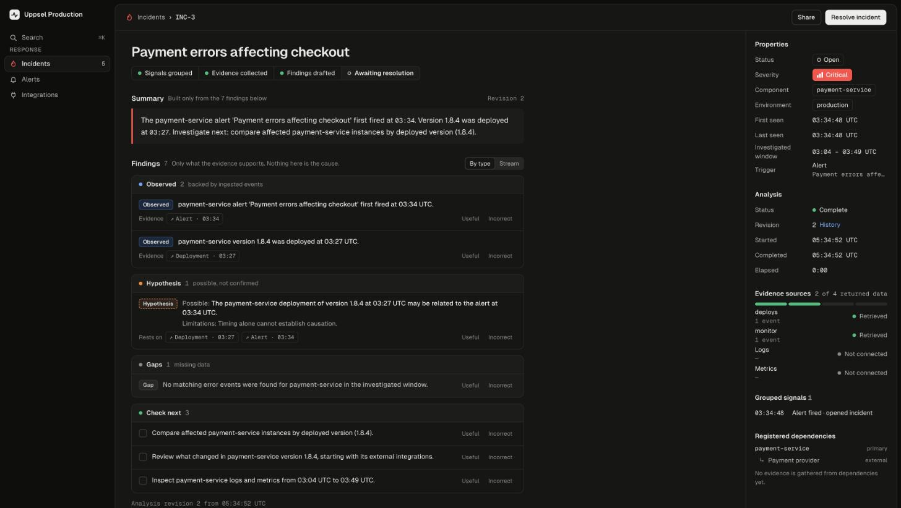
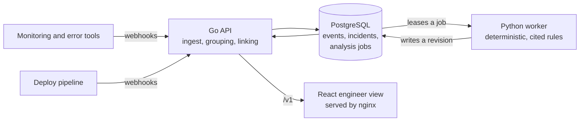

# Sentinel

Sentinel is an incident investigation platform for engineering teams. An alert starts an investigation. Sentinel then finds the affected component, gathers the related evidence, puts it in time order, and suggests careful next checks. Its goal is to shorten the engineer's **time to understanding**.

The core loop is **Ingest → Correlate → Investigate → Explain**. See [`docs/scope/Sentinel_PRD.md`](docs/scope/Sentinel_PRD.md) for the full product requirements.





## How it fits together



An alert opens an incident for its component, or joins the one already open. The API links the deployments and errors for that component inside the incident's window and queues an analysis job, in the same transaction. The worker leases the job, reads the linked evidence and writes an immutable revision of findings, each citing the events it rests on. Evidence that arrives later is linked and triggers a new revision.

## Quick start

Needs Docker with Compose 2.24 or later, and Python 3 for the demo script.

```sh
make up        # build and start PostgreSQL, the API, the worker and the UI, with demo incidents
make demo      # send four demo scenarios through the API; each prints PASS or FAIL
```

Then open <http://127.0.0.1:5173> and sign in with `SEED_ADMIN_TOKEN` from `.env`. `make up` creates `.env` from `.env.example` the first time; its tokens are fixed demo values for this local stack only. If you already have a `.env` without them, `make up` stops and prints the lines to add.

| What | Where |
|---|---|
| Engineer view | <http://127.0.0.1:5173> |
| API | <http://127.0.0.1:8080> (`/healthz`, `/metrics`, `/v1/...`) |
| PostgreSQL | `127.0.0.1:5432`, user and password `sentinel` |

Every port binds to `127.0.0.1` only. Move them with `SENTINEL_UI_PORT`, `SENTINEL_API_PORT` and `SENTINEL_DB_PORT` in `.env` or the environment; `make run`, `make test` and the demo follow them. `make down` stops the stack and keeps the data; `make reset` deletes the data and starts again.

### The demo scenarios

`python3 scripts/demo.py <scenario>` runs one of them (`make demo` runs all four):

- `happy`: a deployment, then an error, then an alert. The incident links all three and suggests the deployment may be related.
- `missing-deployment`: an alert with nothing else. Sentinel says that change data is missing and offers no hypothesis.
- `late-deployment`: the alert is analysed, then the deployment arrives. A second revision appears, and the revision history shows what changed.
- `duplicate`: one alert sent twice. The second send gets the first event back.

Each run registers its own component (`demo-<id>`), so runs never see each other's events. Each scenario prints the timeline, the findings and a link to the incident in the UI. The demo calls `SENTINEL_URL` if set, otherwise the API on `SENTINEL_API_PORT`, then `PORT` (for `make run`), then 8080.

### The demo incidents

`make up` and `make run` fill the demo tenant with incidents to explore, so every part of the engineer view has something in it: severities from info to critical, a repeat alert that escalates, deployments and errors as evidence, revision histories (from late evidence, a repeat alert and a manual reanalysis), findings marked useful and incorrect, a next check marked done, incidents resolved by their monitor and by an engineer with a cause note, an unmatched resolution on the Alerts page, registered dependencies two levels deep, and an incident from last week for the time filters.

They are written by `sentinel-api demo-data` through the same services the API uses, and analysed by the real worker, so they appear over the first half minute or so after start. Event IDs are fixed, so restarting adds nothing. Set `SEED_DEMO_DATA=0` (or `false`, `no`, `off`) to start with an empty tenant. If a run stops partway (the worker was down, say), the next start finishes it with the same timings. An analysis that is waiting or running needs the worker stopped (below); a failed one cannot be produced this way.

### Send an event yourself

```sh
source .env
INTEGRATION=$(curl -s -H "Authorization: Bearer $SEED_ADMIN_TOKEN" http://127.0.0.1:8080/v1/projects \
  | python3 -c 'import json,sys; print(json.load(sys.stdin)["items"][0]["id"])' \
  | xargs -I{} curl -s -H "Authorization: Bearer $SEED_ADMIN_TOKEN" http://127.0.0.1:8080/v1/projects/{}/integrations \
  | python3 -c 'import json,sys; print(next(i["id"] for i in json.load(sys.stdin)["items"] if i["name"] == "monitor"))')

curl -s -X POST "http://127.0.0.1:8080/v1/ingest/$INTEGRATION/events" \
  -H "Authorization: Bearer $SEED_MONITOR_TOKEN" -H 'Content-Type: application/json' \
  -d "{\"schema_version\": \"1\", \"source_event_id\": \"my-alert-1\", \"type\": \"alert.triggered\",
       \"occurred_at\": \"$(date -u +%Y-%m-%dT%H:%M:%SZ)\", \"external_component_id\": \"payments-prod\",
       \"environment\": \"production\", \"severity\": \"critical\", \"fingerprint\": \"my-alert\",
       \"summary\": \"Payment errors affecting checkout\"}"
```

The response holds the new `event_id` and `incident_id`. Send the same body again and you get the same `event_id` back with `"replayed": true`.

### See what happens when the worker is down

```sh
docker compose stop worker
python3 scripts/demo.py happy --no-wait   # the incident shows "Analysis pending"
docker compose start worker               # within seconds it completes, with one revision
```

`curl -s http://127.0.0.1:8080/metrics | grep ^sentinel_` shows ingest outcomes, jobs by status and the age of the oldest pending job.

## Development

`make run` runs the API and the worker as processes on your machine, against PostgreSQL in Docker, and `cd frontend && npm run dev` serves the UI with hot reload. See [`scripts/README.md`](scripts/README.md), [`backend/worker/README.md`](backend/worker/README.md) and [`frontend/README.md`](frontend/README.md).

```sh
make test    # shell helpers, Go API, Python worker and frontend; needs Go 1.26+, uv and Node 22+
```

Choices that set a default (windows, limits, retries, exposure) are recorded in [`docs/adr/0001-phase-1-defaults.md`](docs/adr/0001-phase-1-defaults.md), each with when to revisit it.

## Repository layout

```
sentinel/
├── backend/
│   ├── api/            Go API: ingestion, incidents, evidence, analysis jobs, metrics
│   └── worker/         Python analysis worker
├── frontend/           Engineer view (React + Vite, served by nginx in Docker)
├── docs/
│   ├── scope/          PRD and phase scope documents
│   ├── adr/            Architecture decision records
│   ├── design/         The Ledger visual design
│   └── plans/          Implementation plans
├── scripts/            Local run helpers and the demo driver
├── .github/workflows/  CI
├── docker-compose.yml  Local stack
└── Makefile            Common tasks
```

## How work lands

Each unit of work is a small pull request against `main`. CI runs on every PR, and nothing merges until it has been reviewed. Implementation plans live in `docs/plans/`, and decisions that change defaults are recorded in `docs/adr/`.
