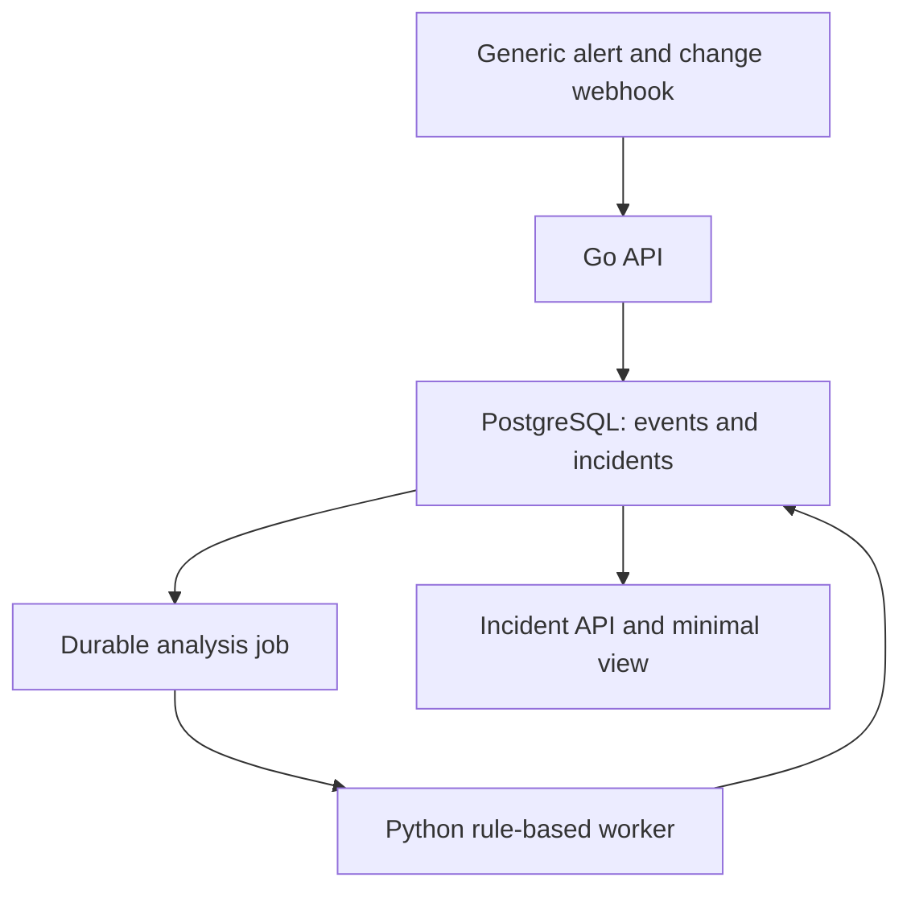

# Sentinel — Phase 1: Core Investigation

**Companion to:** Sentinel PRD v1 and Sentinel North Star  
**Learning block:** Go + Python refresher (the curriculum's Month 1)  
**Status:** Implementation guide · **Date:** 8 November 2026

## 1. Outcome and boundary

At the end of this phase, one authenticated alert can become a durable incident, nearby events for the same component can become a source-linked timeline, and a small Python worker can produce structured, cautious findings. An engineer can inspect the result through an API and minimal view. The system survives duplicate delivery and worker restart.

The product loop is **Ingest → Correlate → Investigate → Explain**. Phase 1 uses a generic webhook and synthetic events. It does not require a native Sentry connector, Loki/Prometheus, an LLM, a broker, Kubernetes, or cloud deployment.

**Important scenario boundary:** V0 correlation examines the *primary component*. To demonstrate a deployment and error linked to an alert, make all three events map to `payment-service`; describe checkout as the user-visible impact in the alert summary. Linking a checkout alert automatically to a payment-service deployment requires an explicit dependency relationship, which Phase 2 introduces. Do not silently infer that relationship in Phase 1.

## 2. Learning application

| Study topic | Where it appears in Sentinel |
| --- | --- |
| Go HTTP, context and errors | Webhook validation, request cancellation, persistence errors and response contracts |
| Go concurrency | Bounded request handling and a deliberate comparison between in-process work and durable jobs; avoid a gratuitous worker pool |
| SQL transactions and constraints | Event deduplication, single open incident per grouping key, and job creation atomically |
| Python typing and data models | Typed incident/evidence input and structured finding output |
| Python database access and testing | Lease a job, assemble evidence, write a revision, test missing evidence and retries |
| Docker and local development | Repeatable PostgreSQL, migrations, API and worker startup |

The course is a resource for implementation questions. Completion of the full Python course is not a release gate.

## 3. User story and walking example

An engineer operates the `Uppsel Production` project. A payment-service deployment completes at 14:02, timeout summaries begin at 14:07, and a monitoring alert reports payment errors affecting checkout at 14:09. They open the incident and see a timeline with those three facts. Sentinel says that the deployment is a *possible lead* and suggests checking the payment integration. It does not declare the deployment the cause.

If the deployment event is absent, Sentinel reports that deployment context is missing. If the same alert is retried, no extra incident or event appears. If the worker is stopped, the incident remains visible with analysis pending.

## 4. Scope and requirements

### 4.1 Tenant and component registration

- Seed one admin membership and organization for the local demo. Model organizations and memberships from the beginning; do not invent a public signup flow yet.
- Support creating/listing a project and components. A component has project, environment, stable identifier, display name and optional owner.
- Create a generic integration scoped to the organization/project, with a capability, enabled state, credential and explicit mapping from external component ID to Sentinel component and environment.
- Integration authentication derives tenant and project. Neither a payload field nor a URL parameter can authorize access to another tenant.

### 4.2 Intake

Accept versioned `alert.triggered`, `alert.resolved`, `error.observed`, and `deployment.completed` events. Require `source_event_id`, occurrence time, external component ID, environment and type-specific fields. Save receipt time separately. Validate size, timestamps and types. Respond with a stable event ID and a clear error code for rejected or unmapped input.

Put a database uniqueness constraint on `(integration_id, source_event_id)`. A replay returns the existing event ID without repeating incident or job side effects. Keep source URLs and safe normalized attributes. Do not store or log integration credentials in the event record.

### 4.3 Incident lifecycle

- `alert.triggered` creates an open incident or attaches to one matching organization, project, environment, primary component and fingerprint.
- Enforce one open incident per matching key under concurrent requests using a transaction plus database constraint or equivalent serialization.
- A distinct repeated alert updates `last_seen`; the same external event is simply a replay.
- `alert.resolved` closes the matching open incident. An unmatched resolution remains an event with a clear status.
- Error and deployment events are evidence candidates; neither opens an incident in this phase. An alert after resolution starts a new incident.

### 4.4 Evidence and analysis

- Query stored events for the primary component/environment from 30 minutes before `first_seen` through 15 minutes after `last_seen`. Treat this as a V0 default to revisit.
- Store incident-event links with a reason such as `trigger` or `same_component_time_window`. The link represents relevance, not causality.
- Persist an analysis job in the same transaction as a newly created incident, or through a transactional outbox. Use a database-backed lease/retry job in this phase.
- Python worker writes an immutable analysis revision containing observations, hypotheses, unknowns and next checks. Factual observations and hypotheses cite evidence IDs.
- A late relevant event schedules reanalysis; new revision does not erase the event or previous revision. Job retries do not duplicate a revision for the same work item.

### 4.5 Engineer interface

Provide incident list, detail and chronological timeline endpoints. A minimal React + Vite page or simple read-only view can show status, component, source event, timeline, source links, latest revision and pending/failed state. Prioritize correct distinctions between fact, hypothesis and unknown over visual polish.

## 5. Suggested architecture and data

Minimum records: organizations, users/memberships, projects, components, integrations, integration mappings, operational events, incidents, incident-event links, analysis jobs, analysis revisions, findings and finding-evidence links. Add `organization_id` consistently or enforce tenant joins in every query; test isolation at API and storage boundaries.

**Contract rule:** the source reports what it observed; Sentinel assigns its own IDs and records why it linked an item to an incident. The worker reads normalized evidence rather than trusting a raw log string as an instruction.

## 6. Work packages in build order

| Package | Build | Demonstration |
| --- | --- | --- |
| **P1-A: first vertical cut** | Go module, migrations, local PostgreSQL, seeded tenant/project/component/integration, authenticated `alert.triggered` endpoint and incident detail endpoint | Send one curl request; read the incident after restarting the API |
| **P1-B: registration and source mapping** | Project/component APIs, integration credential lifecycle and external-ID mapping | Mapped event accepted; wrong component rejected; disabled integration rejected |
| **P1-C: integrity and lifecycle** | Four event types, deduplication, transactional incident grouping, resolution | Replay, repeat alert, concurrent alert, resolution and recurrence cases pass |
| **P1-D: timeline and fixture** | Event links, ordered timeline, deployment/error fixture with out-of-order arrival | Three facts appear in occurrence order and have source references |
| **P1-E: analysis** | Database job lease/retry, Python worker, revision schema and rules | Worker restart recovers; missing evidence produces an explicit gap |
| **P1-F: review surface** | Incident list/detail view, status/error display, short setup guide | Engineer completes the exercise without querying the database manually |

For P1-A, a seeded integration credential is acceptable; add management endpoints in P1-B. Keep migrations and a fixture script in source control so the demo can be reset and replayed.

## 7. Required acceptance scenarios

1. **Happy path:** deployment, error and payment-service alert create one incident with a three-event timeline and cited, cautious findings.
2. **Idempotency:** sending an identical external event twice returns the same Sentinel event ID; counts remain unchanged.
3. **Repeated alert:** a distinct alert with the same open grouping key updates that incident.
4. **Tenant/component isolation:** a second organization or component cannot view, resolve or join the first incident.
5. **Late event:** a deployment received after the alert but with earlier occurrence time appears correctly and creates a new analysis revision.
6. **Unknown cause:** alert with no supporting evidence still produces a useful incident; the analysis does not invent evidence.
7. **Worker failure:** a stopped worker leaves the incident pending and eventually completes the job after restart.
8. **Mapping failure:** unknown external component returns an actionable mapping error and never attaches to a guessed component.
9. **Resolution:** a matching resolve closes the incident; a later trigger opens a new one.

Unit-test pure normalization, grouping and finding rules. Integration-test the database constraints, transactions, job retry and tenant boundary. The scripted fixture is the end-to-end gate.

## 8. Decisions and failure cases

| Decision | Phase 1 default | Revisit when |
| --- | --- | --- |
| Job transport | PostgreSQL-backed leased job/outbox | Measured contention, multiple independent consumers or delivery requirements justify a broker |
| Analysis | Deterministic Python rules | Real evidence and evaluation cases exist for AI |
| Evidence window | 30 minutes before and 15 minutes after incident | Incident exercises show missed or noisy evidence |
| UI | Small read-only incident surface | Engineers need a richer investigation workflow |
| Related services | No implicit cross-component match | Phase 2 dependency mappings are available |

Do not acknowledge an event before its database transaction commits. Do not conflate no evidence with health. If an event is too late to fit the V0 window, keep the event but do not silently rewrite the incident's start.

## 9. Exit package and handoff

Deliver a runnable repository, migrations, fixture data, API examples, a short architecture diagram, integration and tenant tests, and one recorded walkthrough showing both the happy path and missing-evidence variant. Record any changed defaults in a short ADR.

**Phase 2 starts from this working baseline.** Carry forward a list of observed shortcomings: sources that need native adapters, false/missed event links, query latency, grouping ambiguities and job behavior under load. Those observations drive the distributed design rather than a predetermined technology list.
